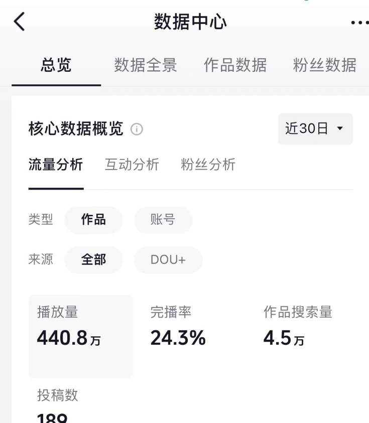

# How to read a post analytics panel

When reading analytics, confirm the **reporting window and date range** first, then compare how
different posts performed.

## Start with the overall trend

Do not judge by a single day. Watching a stretch of time makes changes in your content easier to
understand.

> Read images together with their context, otherwise numbers get interpreted outside their
> definitions.

## Check in this order

1. Confirm the date range.
2. Look at the number of posts.
3. Compare views and engagement trends.

These steps only illustrate article layout. They are not a promise of reach or revenue.
